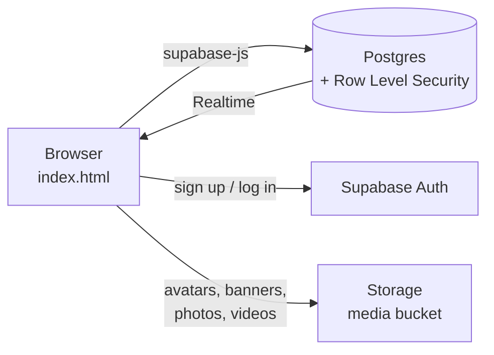
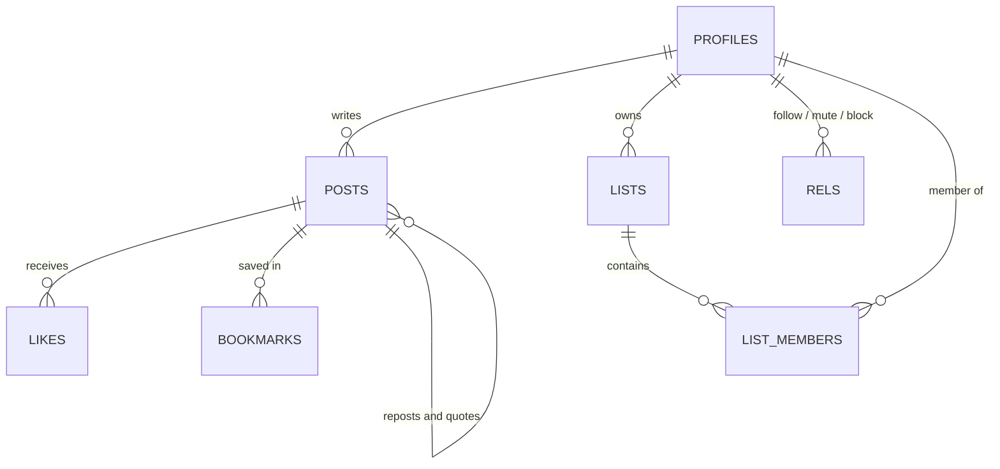

<div align="center">

# Pulse

**A fast, minimalist microblogging app with accounts, media posts, lists and live updates.**
One HTML file on the front end. Supabase for everything behind it.


[Quick start](#-quick-start) · [Features](#-features) · [Deploy](#-deploy) · [How it works](#-how-it-works) · [Troubleshooting](#-troubleshooting)

<!-- Add a screenshot after your first deploy:

-->

</div>

---

## Features

| | |
|---|---|
| **Accounts** | Sign up and log in with email and password. Each account gets a unique `@handle` automatically. |
| **Guest preview** | Logged-out visitors see a faded preview of the feed and a sticky bar asking them to sign up or log in. |
| **Profiles** | Edit your name and bio, and upload an avatar and header banner straight from your device. |
| **Posts with media** | Publish text with a photo or video attached. |
| **Engagement** | Like, repost, quote repost and bookmark. Every post shows live counts for likes, views, reposts and bookmarks. |
| **Three feeds** | **For you** (everyone), **Following** (only people you follow, plus you) and **Lists** (custom feeds you build). |
| **Custom lists** | Create named lists, search for people and add or remove members, then open a dedicated feed for each list. |
| **Follow, mute, block** | Available on every profile and from the menu on every post. Muted and blocked accounts disappear from your feeds. |
| **Live updates** | New posts and likes appear without refreshing, powered by Supabase Realtime. |
| **Dark and light mode** | Follows your system setting, with a toggle in the header. Smooth transitions on tabs, menus, modals and buttons. |
| **Bookmarks** | A private page of everything you have saved. |

## Quick start

You need a free [Supabase](https://supabase.com) account and a text editor. No Node.js, no build tools.

### 1. Create the database

1. Create a new project in Supabase.
2. Open **SQL Editor**, paste the entire contents of [`schema.sql`](schema.sql) and click **Run**.
3. If Supabase warns about Row Level Security, choose **Run and enable RLS**. The script enables it on every table anyway.

You should see "Success. No rows returned."

### 2. Connect the app

Open `index.html` and find this block near the top of the script:

```js
const CFG={url:'YOUR_SUPABASE_URL',key:'YOUR_SUPABASE_ANON_KEY'};
```

| Value | Where to find it |
|---|---|
| **Project URL** | Click the green **Connect** button at the top of the Supabase dashboard. It looks like `https://abcdefghijklmnop.supabase.co`. |
| **Key** | **Project Settings → API Keys**. Use the **publishable** key (`sb_publishable_...`), or the `anon` key from the **Legacy API Keys** tab. |

> **Never put a `service_role` or `sb_secret_...` key in this file.** Those bypass all security rules and would be visible to every visitor.

### 3. Make sign-up instant (optional)

In Supabase go to **Authentication → Sign In / Providers → Email** and turn off **Confirm email**. Otherwise each new user has to click a link in an email before logging in.

### 4. Run it

Double-click `index.html`, or serve the folder locally:

```bash
python3 -m http.server 8000
# then open http://localhost:8000
```

## Deploy

Because there is no build step, deploying means uploading the files as they are.

**Netlify (fastest)**
1. Go to [app.netlify.com/drop](https://app.netlify.com/drop).
2. Drag in the folder that contains `index.html`.

Or connect this repository in Netlify with the build command left empty and the publish directory set to `/`.

**GitHub Pages**
1. Push this repository to GitHub.
2. Open **Settings → Pages**.
3. Under **Build and deployment**, choose **Deploy from a branch**, select `main` and `/ (root)`, and save.
4. Your site appears at `https://YOUR-USERNAME.github.io/REPO-NAME/` after a minute or two.

## How it works



The entire front end is one file of HTML, CSS and vanilla JavaScript. It loads [`supabase-js`](https://github.com/supabase/supabase-js) from a CDN and talks to your Supabase project directly. There is no server of your own to run.

### Data model



- **Reposts and quote reposts are posts.** A repost is a row with `repost_of` set. A quote repost is a row with `quote_of` set and the commentary in `body`. The reposts counter adds both.
- **Follow, mute and block share one table** (`rels`), distinguished by a `kind` column.
- **Counters come from a view** (`post_stats`), so likes, bookmarks and reposts are always computed from the real rows.
- **Views** are incremented by a small `inc_views` function, once per post per page load.

### Security model

Your Supabase URL and publishable key are visible to anyone who opens the page. That is expected. Row Level Security is what protects your data.

| Data | Who can read | Who can write |
|---|---|---|
| Profiles | Everyone | Only the owner |
| Posts | Everyone | Only the author (insert and delete) |
| Likes | Everyone | Only the owner |
| Bookmarks | Only the owner | Only the owner |
| Follow, mute, block | Only the owner | Only the owner |
| Lists and members | Only the owner | Only the owner |
| Media files | Everyone | Signed-in users, into their own folder only |

### Live counts

New posts, deletions and likes arrive through Supabase Realtime. Bookmarks are private, so Realtime cannot broadcast them to other users, and views are updated by a database function. To keep every counter fresh, the app also quietly refreshes the feed every 20 seconds. It skips a refresh while a menu is open or a video is playing.

## Project structure

```
.
├── index.html   # the whole app: markup, styles and logic
├── schema.sql   # tables, policies, triggers, storage bucket, realtime
└── README.md
```

## Troubleshooting

| Problem | Fix |
|---|---|
| Feed shows an error about the API key | Double-check the URL and key in `CFG`. If the publishable key is rejected, try the `anon` key from the **Legacy API Keys** tab. |
| "Check your email to confirm your account" | Confirm the email, or turn off **Confirm email** (see step 3 above). |
| "That handle is already taken" | Handles are unique. Pick another one. |
| Posting works but photos fail to upload | Make sure the last part of `schema.sql` ran, which creates the public `media` bucket and its upload policy. |
| `already exists` errors when re-running `schema.sql` | The first run partly succeeded. Look for the first error message, fix that, or reset the database and run the file once. |
| Page loads but nothing appears for guests | Check that you have at least one post. The guest preview shows the first three. |
| The site stopped responding after weeks of no use | Free Supabase projects can pause when inactive. Open the dashboard and restore the project. |

## Limitations and ideas

Pulse is a solid foundation rather than a finished product. Natural next steps:

- [ ] Replies and threads
- [ ] Follower and following counts on profiles
- [ ] Notifications
- [ ] Hashtags and search
- [ ] Image resizing before upload
- [ ] Email password reset and OAuth sign-in (Google, GitHub)

Upload sizes are limited by your Supabase plan.

## Contributing

Issues and pull requests are welcome. Keep changes dependency-free so the project stays deployable with a single drag and drop.

## License

Released under the [MIT License](LICENSE). Add a `LICENSE` file to the repository root if you keep this license.
